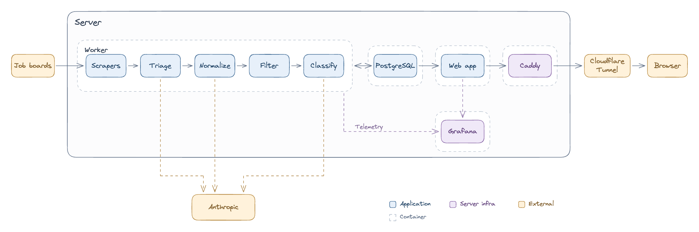

I built my own personal, automated job board, that extracts jobs from companies I'm interested in, classifies them, and then serves them to me from my own infrastructure. This blog post is a technical overview and description of that project.

# Why

Why Ross? Why did you spend the time and energy to build a personalized job board? Why not use Linkedin, Indeed, Trueup, or one of the many hundreds of other job boards out there? Well dear reader, I have several answers to that question.

1. To keep all of my job applications in one place. 

Applying across job platforms is a pain. Previously I would maintain a spreadsheet with links to the actual job site on Lever, Greenhouse, Ashby, etc. But you know what's better than a spreadsheet? A database. Now I have a system to maintain my applications for me.

2. To get metrics into exactly how many jobs a company has actually apply to me, given my career and location constraints. 

 Some employers list 2000 available jobs, it should be easy to work there! Turns out that number goes down quite a bit once I enforced some filtering criteria around positions I actually qualify for and would be willing, or even more narrowly would want, to work in.
 
3. The idea that I know what companies I want to work for, and now I just need to get their new jobs in front of me as soon as possible. 

Jobs for Stripe get hundreds of applications in the first hour they're posted. Does Stripe care about application speed? Does getting my application in earlier give me a better chance? Who's to say! But I figured it can't hurt to be closer to the front.

4. To discover new jobs or career pivots that I think are interesting. 

There are so many disciplines of software engineering that I don't know about. Who's writing compilers for GPU programming languages? And are you taking applications for shadows?

5. Writing some Go code. 

While this project was AI assisted (especially in the frontend) part of my motivation was just to write some Go code. I genuinely enjoy writing code, especially in Go, and I don't get a lot of opportunity to do in my day job anymore. Reasoning about concurrency, asynchronicity, mutexes, and all that other fun stuff that Go is uniquely suited to handle just gets me all excited.

6. Because other job boards provide inconsistent and unpleasant experiences.

If I could get Linkedin to just show me the jobs I care about from the companies I care about as soon as they go up, I'd use that feature no question. Unfortunately, Linkedin seems content to serve me a continous stream of jobs from third party recruiting agencies, crypto companies, and companies located elsewhere.

So I built my own. It's not perfect, but I certainly consider it a step in the right direction. (TODO xkcd job about building your own, 12 competing standards).

# So how does it work?

Here's a high-level overview of the system.

The job board in is a Go worker, which is responsible for ingesting and classifying the jobs, and a Go web service, which is responsible for serving the jobs in a UI. Anthropic's small LLMs are used in the classification pipeline, self-hosted Grafana collects telemetry and metrics, and the whole system runs on an old laptop, made available to the internet by Caddy and a Cloudflare Tunnel.

I'll go into more detail on each component in the sections below. We'll roughly follow the flow of data; how raw jobs move into the system, and make their way to the UI where I can act on them.
## Pipeline

We'll start with the pipeline in the Go worker. This pipeline deals with job data. There are five stages within the pipeline, and different outbox jobs in the worker execute each task. The stages are:
1. Fetching – This pipeline stage uses a variety of methods including public APIs and HTML scraping to load jobs in from defined job boards URLs.
2. Triage – Is the job technical or non-technical? Technical broadly means a position that requires knowledge of computers to build things. Non-technical is everything else, i.e sales, marketing, HR, etc.
3. Normalization – This stage normalizes all the fields that the filter stage cares about, which are location (i.e US, USA, United States, United States of America, U.S, etc.), compensation range, level (Junior, Senior, Staff, Principal, etc.).
4. Filtering – Apply static filers to the normalized fields
5. Classification – Given a set of prompts for descriptions of ideal positions, pick which position a role most closely matches, and score it by how closely it matches.
### Fetching

The first step in the pipeline is Fetching. To date, the job board supports 13 fetchers. There are three kinds of Fetchers:
- JSON API
	- JSON API List Only
	- JSON API List + Get Description
- JSON API + Text
- HTML Scrapers
- XML Feed Readers

TODO: Short description of each scraper

We save jobs and their IDs in a DB, even if we don't end up classifying them. This way, after a fresh scrape, we can just throw away all the old jobs we've seen before, and only send the new ones through the pipeline.

There's some tradoffs to think about when building fetchers, and loading data from job boards more generally. Public APIs are ideal, especially if they have documentation somewhere. This means they're maintained, and less likely to break. HTML scrapers are worse. HTML can change at any time, with any kind of site update, and then the scraper will break without warning. I try to avoid these if possible.

#### Go Channels in Job Fetchers

One fetcher I think is particularly cool is the Workday fetcher. Workday is a JSON API fetcher, but it requires loading a list of jobs first, then loading each job description individually.

TODO

### Triage

Running every job a company posts through normalization and classification would be both expensive, and time consuming, especially when adding a new company with thousands of jobs that all need to be run though the pipeline. Claude Haiku 4.6 runs about $0.80 / MTok for input, and $4.00 / MTok for output. We're also limited to one LLM call every four seconds to stay under Anthropic's rate limiter.

So a question is then, how can we save time and money by sending less overall jobs through the whole pipeline and two stages of LLM compute? Well, we could probably do a form of triaging, and broadly toss jobs that I definitely would have no interest in applying to. I decided here to use "non-technical" jobs as our triage gate. Non-technical jobs might be a Sales Executive, Marketing Partner, GTM Lead, Business Analysts, IT Support, etc.

This is what the triaging step does, using this LLM prompt (TODO), Haiku is used to classify a job as non-technical or technical. Jobs are marked as such, and non-technical jobs are throw away at this stage, and do not make their way further into the pipeline.
### Normalization

We can't make classification or filtering decisions about jobs if we don't have a shared vocabulary. What one company thinks of as a software engineer, might actually be a senior or staff software engineer.

TODO: Explain that this needs work and hands on TLC, example of still getting tailscale canada jobs.

- Locations
- Technologies
- Salary
- Level
- Technologies

### Filtering

At the filtering stage, each job has normalized fields, and filtering is just a question of adding acceptable rangers. For example, I might add a range Mid to Senior for Level, and Remote, USA, and In-Person, Hybrid, for Chicago.

Jobs that fail filtering, are marked with the reason why (ex. failed, location), and stop their journey through the pipeline here.
### Classification

At the classification stage, I should now have jobs that are technical, with normalized fields that passed my filtering criteria. The last classification stage assigns a category, and relevance to the job

TODO list categories, and relevance levels.

Haiku vs Sonnet, choosing haiku due to cost, bc I'm cheap af.

And that's it! That's the end of the pipeline. We started with raw JSON blobs of data, and finished with normalized, filtered, and classified technical jobs that are ready to be evaluated by myself an applied to (or not).
## UI

So now that we have our job data, 

The UI is minimalist, and designed to look like Hacker news or Miniflux, with the canned Gruvbox Dark Hard theme (LINK) that you can configure in VS Code, Zed, Ghostty, and probably much more.

HTMX vs separate FE. I wanted the responsiveness of a SPA, but also the ability to leverage Go templates and minimizing as much JS writing as possible.

TODO: UI screenshots for each section, with a short description
- Dashboard
- Browse
- Company list
- Metrics

# So how does it run?

## Self-hosting on old hardware

Paying for cloud compute is overrated. People hate data centers, and I can't afford an oxide rack, so I used an old laptop as a server.

TODO: Examined AWS lightsail and AWS EC2, talk about costs and cheaper on self-hosted hardare,

TODO: Pic of laptop? Could be fun

TODO: Tailscale vs Cloudflare tunnels

## Observability

Systems are hard to debug if you can't see into them. My observability stack is hosted on the same machine as my job board.

The primary thing to observe is the pipeline itself. Processing thousands of jobs comes with risks. I'm not overly worried about web traffic since there should be exactly one visitor to my site (me), and 9 times out of 10 I'm checking my job board from the same local network that my host is on.

TODO: Pic of metrics / Grafana dashboard?

# Future work

- Evaluate other models
- Rework pipeline stages to use cheap decision models
- Make the UX better
- Automate resume tweaks, cover letters, applications (note that AI is bad at writing, and so this is a hard problem. How much human touch is needed?)
- Figure out faster improvements, tweaks, to get better data and values

TODO: Code is here if you want to take a look

# Appendix
### A Transactional Outbox

Before we discuss each stage of pipeline, I want to briefly talk about the system that the pipeline is build on, which is called a transactional outbox. The idea here is that we're using Postgres as a message queue, because we're also storing data in that same postgres database, and by encompassing our job processing and data storage in the same database transaction, we circumvent the dual write / distributed transaction problem TODO: LINK I'm not going to describe this problem in detail here, but I've attached an article if you're not familiar. (Or I highly recommend Designing Data Intensive Applications, a.k.a the backend bible.)

Why use an outbox pattern? What makes an message queue and specifically an outbox well suited to this task?
- LLM calls take time
- Resilience / durability
- Rate limiting
- First an aside, the dual-write problem / distributed transactions, how an outbox fixes this problem

### LLM Evals

TODO

Goals of this post:
- I'm technical, I can build things
- I'm a senior-level engineer, I think about big problems, tradeoffs, product, cost when I build things

Why did I build this?
Diagram of the pipeline workflow, talk about the outbox pattern
Talk about cost tradeoffs between anthropic models
Talk about scrapers?
Talk about targeted spend (mentioned that some stages of the pipeline could be reworked to take advantage of decision models like Jev)
Talk about observability, screenshot of Grafana here is good
Talk about self-hosting on an old laptop and serving to the internet using jobs.grattafiori.dev
Mention that the build can take advantage of those tests, I forget what they're called, if need be
Mention shortcomings, next steps
Callout that FE is agentic coded, and I didn't read any of it, outside of specifying the technology 

Follow-up posts
- Compare and contrast tailscale and cloudflare tunnels
- Maybe a small aside about the runner pattern that I really like, and option functions
- 
