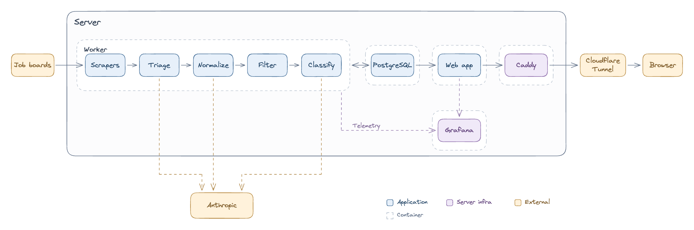
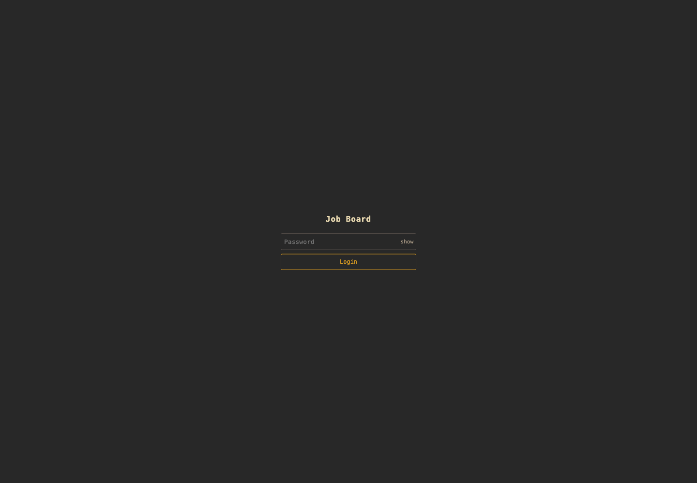
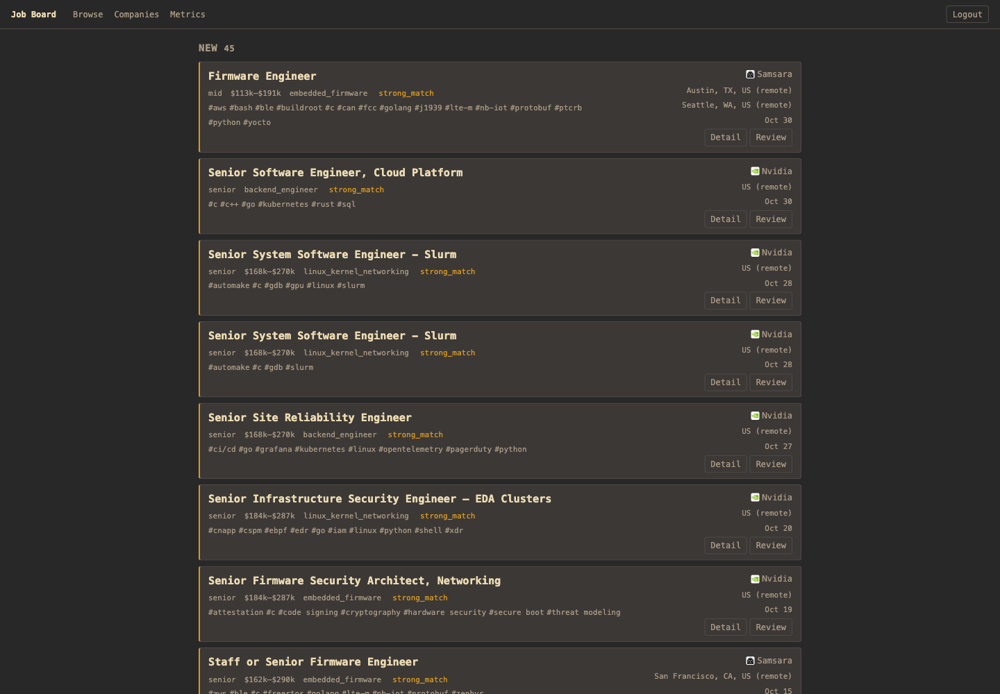
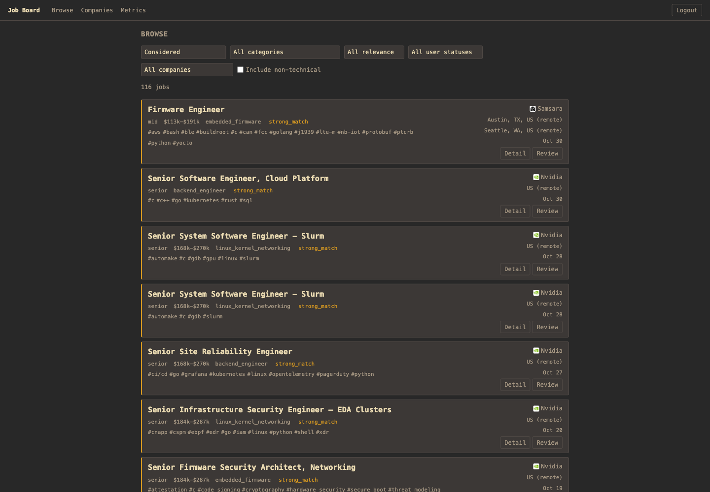
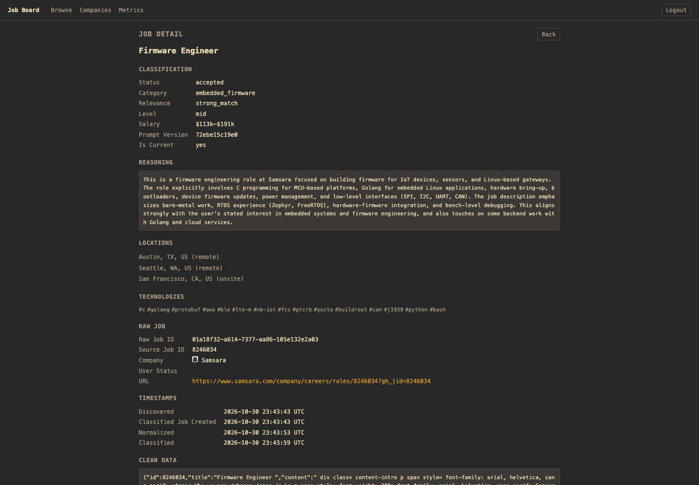
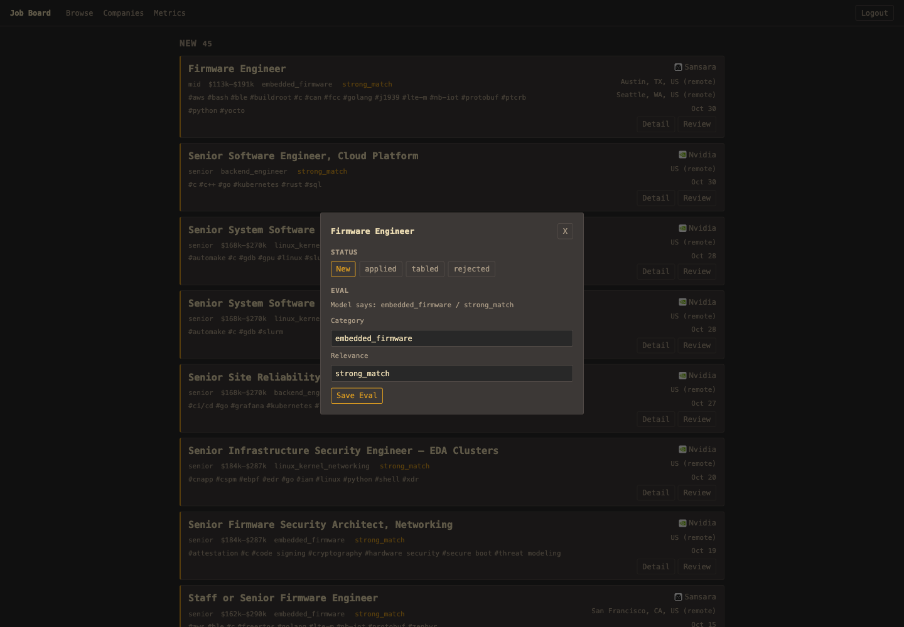
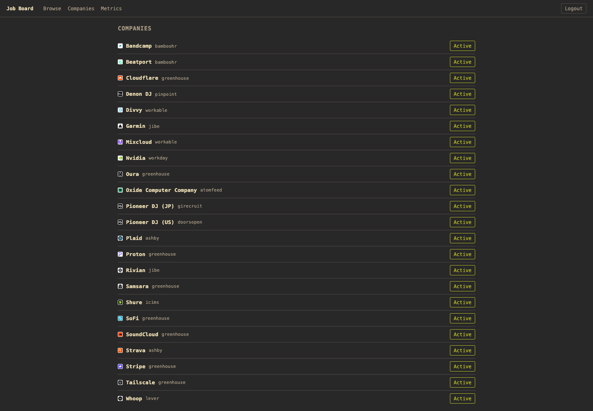
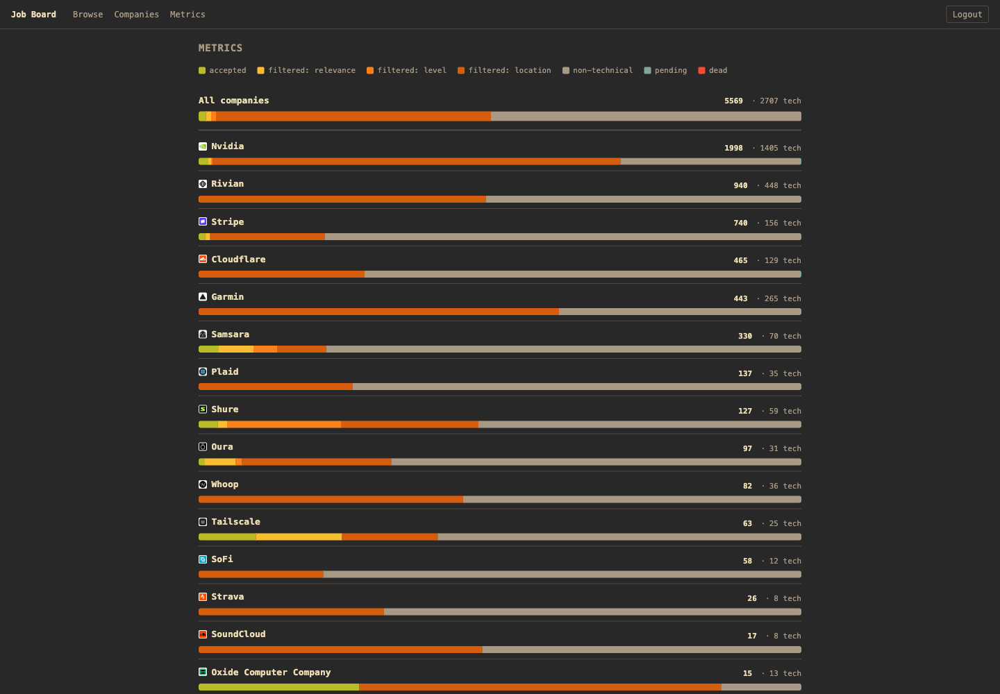

I built my own personal, automated job board that extracts jobs from companies I'm interested in, classifies them, and then serves them to me from my own infrastructure. This blog post is a technical overview and description of that project.
# Why

Why, Ross? Why did you spend the time and energy to build a personalized job board? Why not use LinkedIn, Indeed, Trueup, or one of the many hundreds of other job boards out there? Well, dear reader, I have several answers to that question.

1. To keep all of my job applications in one place.

Applying across job platforms is a pain. Previously I would maintain a spreadsheet with links to the actual job site on Lever, Greenhouse, Ashby, etc. But you know what's better than a spreadsheet? A database. Now I have a system to maintain my applications for me.

2. To get metrics on exactly how many of a company's jobs actually apply to me, given my career and location constraints.

Some employers list 2,000 available jobs. It should be easy to work there! Turns out that number goes down quite a bit once I enforce some filtering criteria around positions I actually qualify for and would be willing, or even more narrowly would want, to work in.

3. The idea that I know what companies I want to work for, and now I just need to get their new jobs in front of me as soon as possible.

Jobs for Stripe get hundreds of applications in the first hour they're posted. Does Stripe care about application speed? Does getting my application in earlier give me a better chance? Who's to say! But I figured it can't hurt to be closer to the front.

4. To discover new jobs or career pivots that I think are interesting.

There are so many disciplines of software engineering that I don't know about. Who's writing compilers for GPU programming languages? And are you taking applications for a shadow?

5. Writing some Go code.

While this project was AI-assisted (especially in the frontend), part of my motivation was just to write some Go code. I genuinely enjoy writing code, especially in Go, and I don't get a lot of opportunity to do so in my day job anymore. Reasoning about concurrency, asynchronicity, mutexes, and all that other fun stuff that Go is uniquely suited to handle just gets me all excited.

6. Because other job boards provide inconsistent and unpleasant experiences.

If I could get LinkedIn to just show me the jobs I care about from the companies I care about as soon as they go up, I'd use that feature no question. Unfortunately, LinkedIn seems content to serve me a useless stream of jobs from third-party recruiting agencies, crypto companies, and companies with in-person requirements located outside Chicagoland.

So I built my own. It's not perfect, but I certainly consider it a step in the right direction.[^1]

# So how does it work?

Here's a high-level overview of the system.



The job board consists of a Go worker, which is responsible for ingesting and classifying the jobs, and a Go web service, which is responsible for serving the jobs in a UI. Anthropic's small LLMs are used in the classification pipeline, self-hosted Grafana collects telemetry and metrics, and the whole system runs on an old laptop, made available to the internet by Caddy and a Cloudflare Tunnel.

In this blog post I'm just going to cover the job board project itself[^2]. I'll go into more detail on each component of that system in the sections below. We'll roughly follow the flow of data: how raw jobs move into the system and make their way to the UI where I can act on them.
## Pipeline

We'll start with the pipeline in the Go worker. This pipeline deals with job data. There are five stages within the pipeline, and different transactional outbox jobs[^3] in the worker execute each task. The stages are:
1. Fetching – This pipeline stage uses a variety of methods including public APIs and HTML scraping to load jobs in from defined job board URLs.
2. Triage – Is the job technical or non-technical? Technical broadly means a position that requires knowledge of computers to build things. Non-technical is everything else, e.g., sales, marketing, HR, etc.
3. Normalization – This stage normalizes all the fields that the filter stage cares about, which are location (e.g., US, USA, United States, United States of America, U.S., etc.), compensation range, and level (Junior, Senior, Staff, Principal, etc.).
4. Filtering – Apply static filters to the normalized fields.
5. Classification – Given a set of prompts for descriptions of ideal positions, pick which position a role most closely matches, and score it by how closely it matches.
### Fetching

The first step in the pipeline is Fetching. To date, the job board supports 13 fetchers. There are roughly four types of Fetchers:
- JSON API
	- JSON API List Only
	- JSON API List + Get Description
- JSON API + Text
- HTML Scrapers
- Atom XML Feed Readers

JSON API fetchers are the simplest of the types. These fetchers make requests to public APIs (ex. `https://boards-api.greenhouse.io/v1/boards/1234/jobs`), and either get a list of all the jobs for the current company with full descriptions, or a list of jobs with abbreviated descriptions, where details need to be fetched with a successive `GET /details` endpoint.

JSON API + Text is similar to the JSON API fetchers, but the details retrieved are downloaded from a text description of a job, rather than in a JSON payload.

HTML Scrapers download whole web pages of listings, then extract the individual job pages from those listings and download the details pages. These scrapers focus on extracting embedded JSON from the HTML, but some scrapers for pages with poor JSON-LD data also extract text from HTML elements.

The last fetcher type is the XML feed reader. Rather than a dedicated, stateful RSS style reader, this fetcher takes advantage of the fact that the only site with an XML job posting page is a small company with limited entries. The fetcher downloads and parses the whole page of ~10 entries on each fetch.

Once jobs are fetched, they're saved as a `RawJob` in the service's Postgres database, and the site-provided IDs are used to dedupe already-fetched jobs on later runs. This deduplication allows the service to toss jobs it has already seen, rather than run them through the rest of the pipeline stages, which saves on money and compute time.

There are some tradeoffs to think about when building fetchers, and loading data from job boards more generally. Public APIs are ideal, especially if they have documentation somewhere. This means they're maintained, and less likely to break. HTML scrapers are worse. HTML can change at any time, with any kind of site update, and then the scraper will break without warning. I tried to avoid these if possible.
### Triage

Running every job a company posts through normalization and classification would be both expensive and time-consuming, especially when adding a new company with thousands of jobs that all need to be run through the pipeline. Claude Haiku 4.5 runs about $0.80 / MTok for input, and $4.00 / MTok for output. We're also limited to one LLM call every four seconds to stay under Anthropic's rate limiter.

So a question is then, how can we save time and money by sending fewer overall jobs through the whole pipeline and two stages of LLM compute? Well, we could probably do a form of triaging, and broadly toss jobs that I definitely would have no interest in applying to. I decided here to use "non-technical" jobs as our triage gate. Non-technical jobs might be a Sales Executive, Marketing Partner, GTM Lead, Business Analysts, IT Support, etc.

This is what the triaging step does. Using [this LLM prompt](https://github.com/rossgrat/job-board-v2/blob/56abb60f51242e05edcda5e6ba9a6352c48ea379/prompts/triage.txt), Haiku classifies a job as non-technical or technical. Jobs are marked as such, and non-technical jobs are thrown away at this stage, and do not make their way further into the pipeline.
### Normalization

I can't make classification or filtering decisions about jobs if I don't have a shared vocabulary between the many different jobs. What one company thinks of as a software engineer might actually be a Senior or Staff software engineer.

The later filtering and, to a lesser extent, classification stages drive what needs to be normalized. Currently I am normalizing four major things.

- Locations – In what city and state/country is the job located? Is the job remote, hybrid, or in-person?
- Technologies – What technologies should applicants for this job be familiar with?
- Salary – What are the maximum and minimum base salaries for the position?
- Level – What seniority level is the position?

The actual data object looks like this.

```go
type NormalizeResponse struct {
	Title        string     `json:"title"`
	Locations    []Location `json:"locations"`
	Technologies []string   `json:"technologies"`
	SalaryMin    *int32     `json:"salary_min"`
	SalaryMax    *int32     `json:"salary_max"`
	Level        string     `json:"level"`
}

type Location struct {
	Country string  `json:"country"`
	City    *string `json:"city"`
	Setting string  `json:"setting"`
}
```

The LLM prompt, with explicit details about things like ISO-3166-1 country codes, non-pluralized technology names, compensation converted to yearly salary, and more, lives [here](https://github.com/rossgrat/job-board-v2/blob/56abb60f51242e05edcda5e6ba9a6352c48ea379/prompts/normalize.txt). Given the prompt, a big blob of variable raw job data, and the object response above, the LLM is expected to fill in the response as best it can.

This is probably the most complex part of the pipeline, and it's also heavily dependent on the initial fetching stage of the pipeline, and more concretely, what information actually gets included in job postings. For example, the Greenhouse Fetcher requires extra API calls to load all of the Offices for which a job is valid. Some companies list a location in the job description, but not the `Location` field that many sites have, which tends to be the `Setting`. Other companies may list a salary, but without the specific unit of currency attached, which must be inferred from the location.

At present, the LLM handles normalization cases like this "well enough", and I will confess I haven't thoroughly QAed much of this pipeline. For this project my main goals were "costs next to nothing to operate" and "displays enough jobs". The current iteration of the pipeline accomplishes both of these goals, but I have no doubt that without dedicated testing and data analysis, or dedicated comparison of low and mid level AI models (say Haiku and Claude), I'm likely failing to surface some opportunities.
### Filtering

At the filtering stage, each job has normalized fields, and filtering is just a question of adding acceptable ranges. For example, I might add a range "Mid to Senior" for Level, and "Remote, USA, and In-Person, Hybrid, in Chicago", for Location.

Jobs that fail filtering are marked with the reason why (ex. failed, location), and stop their journey through the pipeline here.

Below is an example filter entry for a remote, mid-level or senior role, with no salary restrictions.
```json
{
    "id": "019605a0-0001-7000-8000-000000000001",
    "is_active": true,
    "conditions": [
      {"field": "level", "operator": "in", "value": ["mid", "senior"]},
      {"field": "location_country", "operator": "equals", "value": "US"},
      {"field": "location_setting", "operator": "equals", "value": "remote"}
    ]
  }
```
### Classification

At the classification stage, I should now have jobs that are technical, with normalized fields that passed my filtering criteria. The last classification stage assigns a category and relevance to the job.

Categories align with what I'm interested in today, and there are five of them.
- `backend_engineer` – The role I'm in now. Traditional distributed systems and backend engineering, usually for web companies.
- `embedded_firmware` – Embedded systems, firmware, and hardware-adjacent engineering.
- `linux_kernel_networking` – Roles like OS development, low-level systems integration, etc.
- `other_interesting` – Roles like compiler engineering, standard library development, database internals, etc. Things that I think are really cool but might not necessarily know are out there.
- `not_relevant` – Anything that doesn't fall into the first four categories goes here.

These categories are totally subjective. There are basically two categories of non-general, bookkeeping categories. "Jobs I could probably get pretty quickly", which is `backend_engineer`, "Jobs I think are really cool but need to pivot/reskill for", which is `embedded_firmware` and `linux_kernel_networking` (to be read as "Linux, Kernels, and Networking").

Once the LLM has categorized the job, relevance is next. Relevance levels answer the question: "How strongly does this job posting fit the assigned category?" Relevance levels are:
- `strong_match`
- `good_match`
- `partial_match`
- `weak_match`
- `null` – Only used when the assigned category is `not_relevant`

The LLM prompt is [here](https://github.com/rossgrat/job-board-v2/blob/56abb60f51242e05edcda5e6ba9a6352c48ea379/prompts/classify.txt).

Classification is a difficult problem, much like normalization. It's particularly difficult because of the relevance levels. LLMs are pretty good at bucketing things, for example in triage as technical and non-technical, or in classification into one of the five categories. LLMs are also pretty good at pulling out standardized data, like in the normalization stage. Asking an LLM to score something is more black-box-esque, because scores, to some degree, are subjective, and the LLM might not give the same score to two very similar pieces of data.

I think that the solution to the subjectivity of scoring and relevance levels is evals. Evals in this scenario are a dedicated data set where each entry corresponds to some category and relevance level. So I could create four blobs of job data, then categorize them as `backend_engineer`, and `strong_match`. Then I could point my LLM at this test data set, and run it, and ensure that whatever current prompt I have configured outputs data that match the answers to the test set.

While that may be my preferred solution, and while this project actually does have support for evals (it actually has support for "dynamic" evals, in that for each job surfaced, I can add what I think is the correct classification, and that real raw job and my classification get added to the test set), I have not yet put the effort into this project to make those evals good.

And that's it! That's the end of the pipeline. I started with raw JSON blobs of data, and finished with normalized, filtered, and classified technical jobs that are ready to be evaluated by myself for application worthiness.
## UI

So now that I have my job data, how do I access it? The answer is through a dedicated web UI.

The web server serves the frontend as HTMX, which is sort of a mix of Go's templates and a single-page application framework. I had an agent do pretty much all of the frontend for me outside of creative direction, so I don't have a lot of details here. I wanted something simple and responsive. The resulting UI is minimalist, and it is designed to look like Hacker News or Miniflux. It uses the canned [Gruvbox Dark](https://github.com/morhetz/gruvbox) theme that I use for my terminal and IDE.

Some screenshots of the UI are below.

The first screenshot is of the login page. I could definitely put this behind my Tailscale network, but for now it's available at https://job.grattafiori.dev via a Cloudflare Tunnel behind this password-protected login page.



Below is the main dashboard. There are two sections here. The first is "New". The second is "Tabled", as in I'll get to it later. You can see the shape of the job card in this dashboard. The fields populated in normalization and classification are prominently displayed, along with the company name and logo.



The "Browse" page is similar to the dashboard, but with dropdown filters, and the ability to see jobs that didn't make it all the way through to classification, including jobs dumped immediately as non-technical.



Clicking "Detail" on any job brings up the "Job Detail" page. This page is directionally more aligned with examining pipeline stage outputs than providing a usable overview of the job itself. The underlying job posting is linked to the title in the job card, and so the actual employment site is the intended location for learning more about the job.



Selecting "Review" opens up a review modal, where a new entry can be sorted into applied, tabled or rejected. If rejected is selected, an optional "Reason" box will appear. The unused eval functionality is also present here.




The "Companies" page lists all companies with their favicon, the fetcher used to retrieve them, and whether or not they're active, with new jobs being loaded into the pipeline.



The "Metrics" page gives a simple chart about the number of jobs at each company, and in what pipeline stage they ended up.



# Wrap-up

I think this project is pretty cool, but there is certainly more work that can be done.
- As I've mentioned, the LLM phases need to be QAed. This would likely be a substantial data quality gain.
- Other models could be evaluated for effectiveness in the different pipeline phases. I'm specifically interested in possibly reworking some of the stages to take advantage of decision models like Jev.
- The UX could be quite a bit better. I'm not a designer, and it's not a great focused, job application experience right now. Rather, it feels like a disjointed collection of data.
- It would be great to use LLMs to automate applying to jobs at the click of a button, especially for sites with simple job application processes like Greenhouse and Ashby. The line to walk here is how to make the LLM only apply to the jobs, while retaining any application content and answers to be my own.

That's it! Thanks for reading. The code is [here](https://github.com/rossgrat/job-board-v2) if you want to take a look. Feel free to drop me any comments at blog@grattafiori.dev.

– Ross


[^1]: [There are too many job boards. I should just build one, universal job board to cover every use case!](https://xkcd.com/927/).
[^2]: I plan to write a follow-up post discussing my personal infrastructure, including serving and observability.
[^3]: I think the transactional outbox design in this project is really cool, and I plan to cover that in (another) follow-up post.
